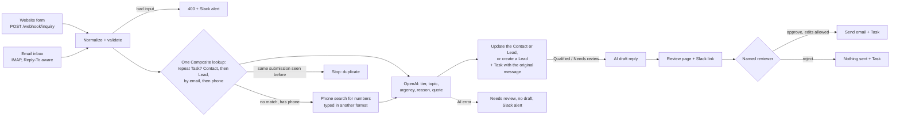

# AI Lead Intake for Salesforce (n8n + OpenAI)

An n8n setup for teams that still read every inquiry by hand and copy it into Salesforce. Inquiries come in from a website form and an email inbox. Each one is matched to an existing Contact or Lead, or added as a new Lead, and OpenAI sorts it as Qualified, Needs review or Not qualified. For leads worth answering it also drafts a reply, but a person has to approve that reply before it goes out.

This is the Salesforce version of [AI Lead Intake for HubSpot](https://github.com/rikkadawufa/ai-lead-intake-hubspot). It uses the same test inquiries, prompts, OpenAI model and review page. Only the CRM step was rebuilt, and both versions pass the same eight test scenarios.

The business is fictional: Tidewell Commercial Cleaning, an office cleaning company. All test inquiries are made up and use the reserved `example.com` / `example.org` domains and 555-01xx phone numbers.

## What it does

### Intake

`wfFormIntake` takes a JSON POST from a website form. `wfEmailIntake` watches the inbox over IMAP and takes the sender from `Reply-To` when there is one, since many contact forms send notification emails that way. Both turn the inquiry into the same shape: lowercased email, phone in E.164 format, message text with quoted replies removed, and a source ID (the form submission ID or the email's Message-ID). An inquiry with no email and no phone gets an HTTP 400 and a Slack alert, and nothing is written to Salesforce.

### Matching and de-duplication

One Composite API call asks Salesforce four things at once: is there already a Task with this source ID, a Contact with this email, an unconverted Lead with this email, or either one with this phone number. These are SOQL queries, so they find a record created a few seconds earlier.

- A Task with the same source ID means the inquiry was already handled (a form submitted twice, an email processed again). The workflow stops there: no AI call, no new Task, no second draft. The source ID field is unique in Salesforce, so a second Task with the same ID can't be saved.
- A matching Contact wins over a matching Lead, and email wins over phone. A known customer writing in gets the inquiry on their Contact, and no Lead is created for them.
- If nothing matches and the inquiry has a phone number, a separate phone search (SOSL) looks for the number typed in another format, such as `(510) 555-0199`. Salesforce's Composite API doesn't accept search requests, which is why this is its own call. New records take a few minutes to show up in search.
- If nothing matches at all, a new Lead is created. The workflow never creates Contacts or converts Leads. If a Salesforce duplicate rule blocks the new Lead, the workflow reads the record the rule points to and updates that one instead. That path is built but wasn't triggered in the tests.

If any part of the lookup fails, the workflow stops and posts the error to Slack, so a broken query can't pass for "no match".

### Classification

OpenAI returns a tier, topic, urgency, a one-line reason and a short quote from the message, all in a strict JSON schema. Code checks the values and that the quote really appears in the message. A long quote that is still word for word is shortened rather than rejected. If the call fails or the answer doesn't pass these checks, the lead is still saved as Needs review with no draft, and Slack gets an alert. A record that was Qualified is never downgraded by a later message. The sorting rules are plain text in [prompts/qualify.md](prompts/qualify.md).

### Salesforce record

Six custom fields on Lead and Contact hold the result: `Lead_Tier__c`, `Inquiry_Topic__c`, `Inquiry_Urgency__c`, `Inquiry_Source__c`, `AI_Reason__c` and `Phone_E164__c`. Each inquiry is also saved as a completed Task on the record, with the source, time, original message and the AI's call, so a sales coordinator can check the reasoning against the message. Existing names, emails and phone numbers are never overwritten; the workflow only fills fields that are empty. Every field is listed in [docs/FIELD-MAPPING.md](docs/FIELD-MAPPING.md).

`scripts/salesforce_setup.py` creates the fields and a permission set for them. It's safe to run again.

### Human approval

For Qualified and Needs review leads, the AI drafts a short reply. The draft goes on a review page with the original message, the AI's reasoning and a link to the Salesforce record, and Slack gets the link. The reviewer can edit the subject and body, then approve or reject. The reviewer's name is required, and an incomplete form is sent back without anything going out. Approving sends the edited version by SMTP and adds a Task like "AI reply approved by Morgan Lee (Ops)", with whether the draft was edited and the text that went out. Rejecting sends nothing and records who rejected it. If nobody responds within 72 hours, nothing is sent (this timeout path is built but wasn't exercised in the test runs).

In demo mode every approved reply goes to a test inbox instead of the made-up customer address, and the subject shows who it would have gone to.

`wfErrorHandler` catches failures in any of the workflows, masks anything that looks like a token, and posts the error to Slack.

## Tested

Eight scenarios shared with the HubSpot version (T1 to T8) plus one that only Salesforce has (T9), checked by `scripts/collect_results.py` against the run logs, Salesforce and the demo inbox. The counts come from code, not from the AI.

| # | Scenario | Result |
|---|---|---|
| T1 | Qualified form inquiry | New Lead, Qualified, draft edited then approved |
| T2 | Same person follows up by email | Same Lead, two inquiry Tasks, still Qualified |
| T3 | Same form submitted twice | Stopped as a duplicate, one draft only |
| T4 | Sales pitch by email | Not qualified, no draft |
| T5 | "How much do you charge?" | Needs review, draft rejected, nothing sent |
| T6 | No email and no phone | HTTP 400, Slack alert, nothing in Salesforce |
| T7 | OpenAI returns an error (a model name that doesn't exist) | Saved as Needs review, no draft, Slack alert |
| T8 | Review page | Incomplete review refused (422); T1 sent with the edits, T2 sent as drafted, T5 not sent |
| T9 | An existing customer (a Contact) writes in | Inquiry Task on her Contact, no Lead created, draft rejected |

Runs on a free Salesforce Developer Edition org, a Gmail test inbox and Slack, with n8n running locally:

- Mock AI (recorded answers): T1 to T8 8/8, T9 passed. Sending the same batch a second time created no new records or drafts.
- Phone matching, two extra form posts in the mock run: a number written as `510.555.0177` matched the Lead stored as `+15105550177`, and `510-555-0199` matched a Lead typed in by hand as `(510) 555-0199` through the phone search.
- Live OpenAI (`gpt-4.1-mini`), first run: T1 to T8 8/8, T9 passed. The HubSpot version needed two live runs to get there; the fix it needed (shortening long quotes) was already in place here.

[results/](results/) has both live results, and `scripts/compare_results.py` puts them side by side. Details, including what went wrong along the way, are in [docs/VERIFICATION.md](docs/VERIFICATION.md) (in Traditional Chinese).

## Known limitations

- Reply drafts don't see earlier inquiries from the same person. In the live run, the draft for T2 asked Dana for her office size and cleaning frequency, which she had already given in her first form. Right now the reviewer has to catch this. Passing the record's earlier inquiry Tasks into the draft prompt would fix it.
- Drafts can promise more than they should. In the live run, the T9 draft said "We can definitely add carpet cleaning … during your next monthly deep clean", although the prompt says not to commit to dates. The reviewer rejected it, which is what the approval step is for, but the prompt alone doesn't stop it.
- `AI_Reason__c` describes the latest message, while `Lead_Tier__c` keeps the highest tier. After T2, Dana is Qualified, but the reason field explains why the follow-up on its own looked like Needs review.
- The phone search only finds records a few minutes after they're created. A record typed in seconds before a phone-only inquiry arrives won't be found that way.
- The review page is served by n8n on localhost, and the reviewer types their name; there's no sign-in. A team setup would need n8n on a reachable host with access control in front of it.
- Tested on a Salesforce Developer Edition org only. Not tested with a production or sandbox org, Person Accounts, Web-to-Lead, assignment rules, or other CRMs.

## Not included

WhatsApp or social media intake, an auto-reply chatbot, follow-up sequences, opportunities, lead conversion or assignment, lead scoring numbers, and production hosting.

## Running this for your own team

This repo runs a demo for a made-up company on localhost. Putting it to work for a real team takes more:

- Hosting n8n somewhere reachable, with sign-in in front of the review page
- Setting up the fields, the integration user and its permissions in your Salesforce org, plus keys and an alert channel
- Fitting it to how your org already works: page layouts, duplicate rules, lead assignment and conversion
- Rewriting the sorting rules and the reply tone for your business
- Connecting your own form and inbox, or another channel such as WhatsApp
- Testing with your real kinds of inquiries before anything goes live, and keeping it working when Salesforce, OpenAI or Gmail change something

This is the part I do for clients.

## Tech stack

- n8n 2.44.7 in Docker, bound to localhost (port 5680)
- Salesforce REST API v63.0 (Composite, SOQL, SOSL, sObjects, Tooling for setup) with the OAuth 2.0 client credentials flow of an External Client App
- OpenAI Chat Completions with strict JSON schema output, plus a mock mode that runs the same workflows on recorded answers
- Gmail over IMAP and SMTP with an app password
- Slack incoming webhook
- Python standard library and Node.js built-ins only, no third-party packages

## Quick start

See [docs/SETUP.md](docs/SETUP.md) to run it, and [docs/OPERATIONS.md](docs/OPERATIONS.md) to change the rules, add a source or handle alerts.

This is a self-initiated portfolio project. The company, people and inquiries are fictional.

## License

Copyright © 2026 rikkadawufa. All rights reserved. No license is granted to use, copy, modify, or distribute this code.
